# **git-turorial** 
###### *Written by James Buchanan (2026)*
This is a tutorial for how to use git and GitHub in VSCode for version controlling files with remote storage. This tutorial focuses on using git in the command line. 

*Key*:
- `Code section`: Highlighted monospaced font indicates text refers to code sections.
- > **🔔 IMPORTANT**: *Important tag with italicised text indicates a section is particularly important to remember.*

# **Overview**

### *What is git?*
Git is a widely used and highly popular system for version controlling electronic documents, particularly software development and data projects. Git allows the state of documents to be stored as editing occurs over time, creating a timeline of versions. This allows the user to both save ‘snapshots’ of the state of their work as it progresses and to revert to previous versions if required. Git stores these changes to a hidden ‘.git’ file allowing changes to be referenced without storing full historical files.

### *Where are my files stored?*
Git is a ‘distributed’ version control system, meaning a copy of the complete codebase or project directory is stored in the cloud and on the computer of all users. This allows users to interact with the same project simultaneously using several commands that are entered into a “Command Line Interface” (CLI) otherwise known as the terminal.

### *What is the difference between git and GitHub?*
Git is the version control software itself used locally on your computer, while GitHub is a Microsoft cloud storage website for storing your files. Git allows us to track our changes while GitHub remotely stores our up-to-date files and edit history.

### *What are the common git commands?*
`init`
-	To turn a regular directory into a git directory, we use the `init` command (short for initialise). This creates our ".git” file. To do this, we first navigate to our local directory and type `git init` into our terminal and press enter; Changes made to our directory are now tracked by git.

`add`
-	Once we have our git-tracked directory, we can begin adding and editing files as we normally would. The `add` command allows us to snapshot or “stage” our changes by typing `git add example_file.txt` into our terminal and pressing enter. 

`commit`
-	Now that we’ve staged our file edits in git, we can store our them. To do this, we use the `commit` command to move our edits from the staging area to our “local repository” (a storage of the most up-to-date state of our local directory). In our terminal we can enter `git commit -m “Add greeting to example_file.txt.”` to store our changes. 
-	Using `-m` tells git that we’d like to include a “commit message”, these messages help us later track why we made our commits and are helpful for describing our changes.

`push`
-	So far everything we have done in git has been local to our computer. While git can be used this way, often it is helpful for us to store our changes in a “remote repository” (you'll often see these referred to as 'repos'). 
-   To move our local changes to the cloud we can enter `git push` into our terminal. We have now synced our local files with the remote repo and we’re ready to continue editing. 

`pull`
-   `pull` is the opposite of `push`; So while `push` is used to move files from your computer to GitHub, `pull` is used to move files from GitHub to your computer.

### *Why use git/GitHub?*
- Files are frequently modified, updated, or lost and so having a way of tracking change and storing up-to-date files remotely becomes hugely useful as any project grows in complexity. git allows us to store changes we make to files over time to: **A**) Revert to older versions; **B**) Track the history of a documents; **C**) Test out multiple versions.
- Storing files remotely on GitHub allows for: **A**) Effective collaborative editting; **B**) Safe storage of files; **C**) Better workflow organisation.
- Once you begin using git and GitHub the question rather becomes "why *woudln't* I want to use git/GitHub?".

Now that we’ve summarised what git and GitHub are, as well as how they can be useful, we can set up git and GitHub and practise this ourselves. 

# **Setup**

This setup covers three main parts: 
-   Installation and setup of git 
-   Installation of VSCode to use git
-   Creation and configuration of our GitHub account.

### *1) Installing git*
Firstly, we will need to install git. You can find the download for Windows [here](https://git-scm.com/) (*see below*).

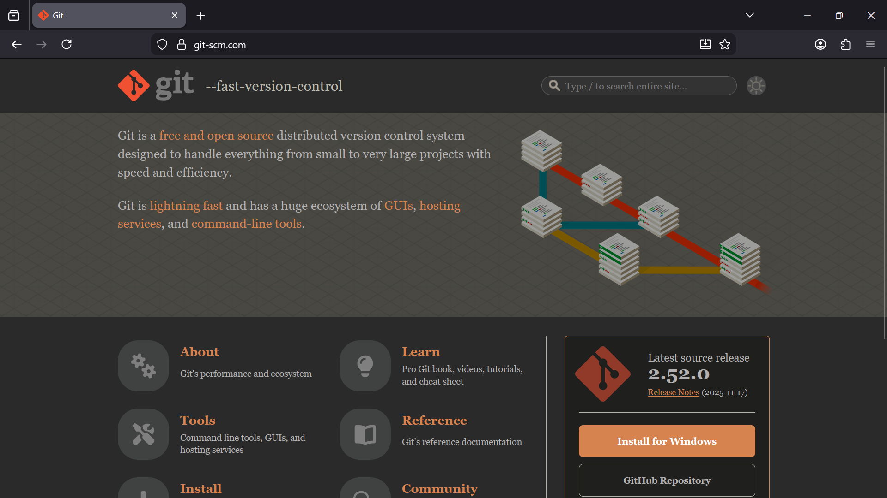 

Once you click "Install for Windows", you'll arrive at the below webpage. Select the "Git for Windows/x64 Setup" option and a download will begin.

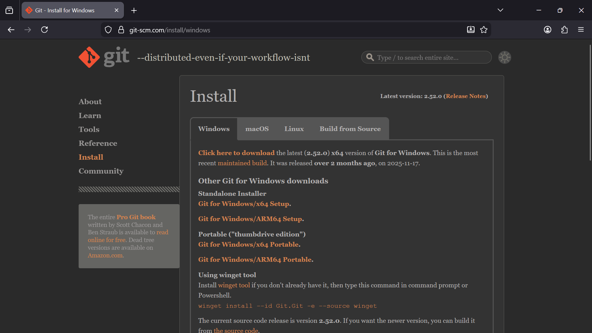 

Once downloaded, run the ".exe" file, the below setup window should appear.

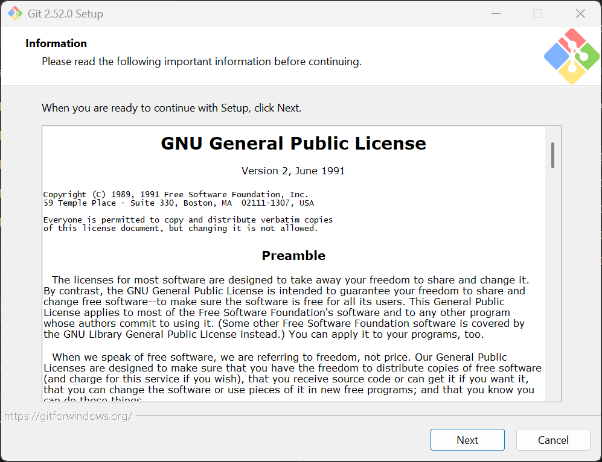 

Accept all default settings in the installer with the exception of "Choosing the default editor used by Git", we're going to select Visual Studio Code (See below).

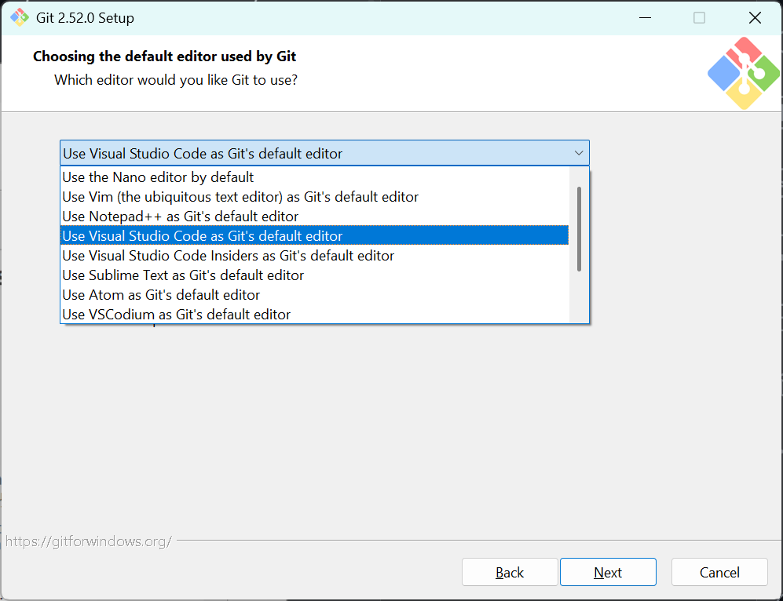 

Once git is installed, we will need an interface to use it (remember, we selected Visual Studio Code or VSCode earlier).

### *2) Installing VSCode*
We will now install VSCode. This is a basic text editor developed by Microsoft, primarily for coding and writing, however it seamlessly integrates with git and GitHub. Navigate [here](https://code.visualstudio.com/) and click "Download for Windows" (*see below*).

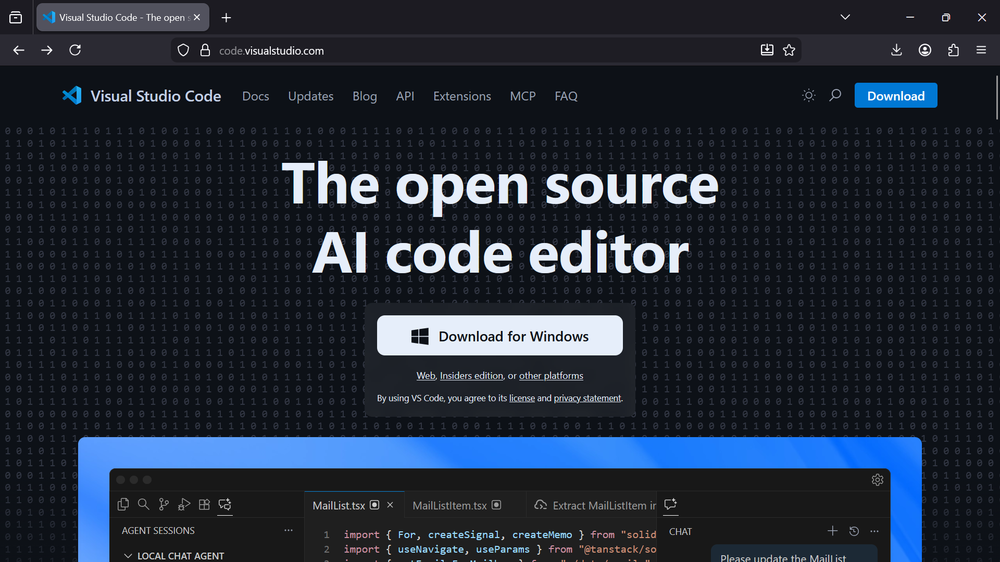 

### *3) Creating a GitHub account*
Next, if you don't yet have a GitHub account, we will need to create one. Navigate [here](https://github.com/) and click "Sign up for GitHub" and enter your University of Aberdeen email address (*see below*). 

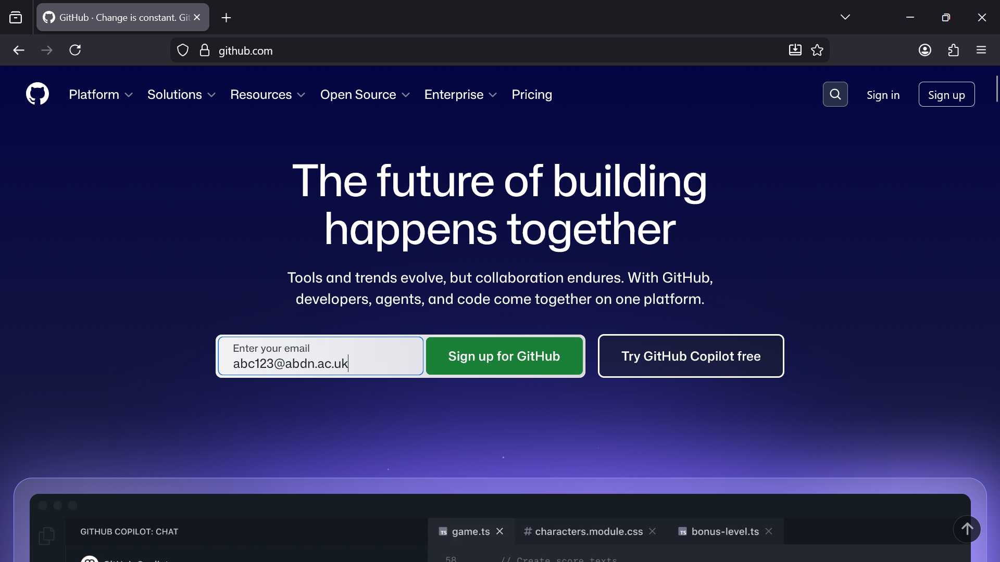 

You will be prompted for a username, you should preferablly enter your University of Aberdeen login (e.g. a10bc5). You should enter a strong memorable password (I suggest using a passphrase generator such as [this tool](https://bitwarden.com/password-generator/#password-generator) (*see below*).

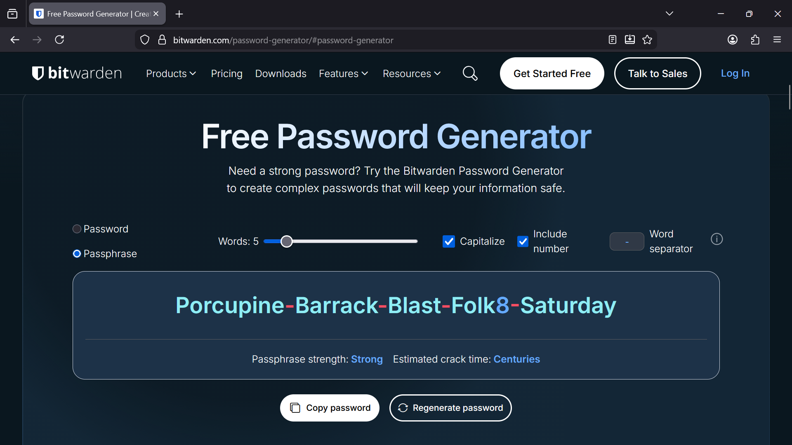 

Once your account is created, you can contact the IT Service Desk by [email](servicedesk@abdn.ac.uk) or via their [website](https://www.abdn.ac.uk/toolkit/services/it-service-desk/) to ask to be added to the "Planning" team within the University of Aberdeen GitHub organisation. The Planning team is a place to store repositories 

### *4) Configuring git terminal in VSCode*

Now that we've installed git, created a GitHub account, and installed VSCode, we're ready to configure VSCode. 

First, we'll configure git to be our default terminal. Within VSCode, either press `ctrl+shift+'` to open the terminal or navigate the top menu bar to `Terminal/New Terminal` (*see below*).

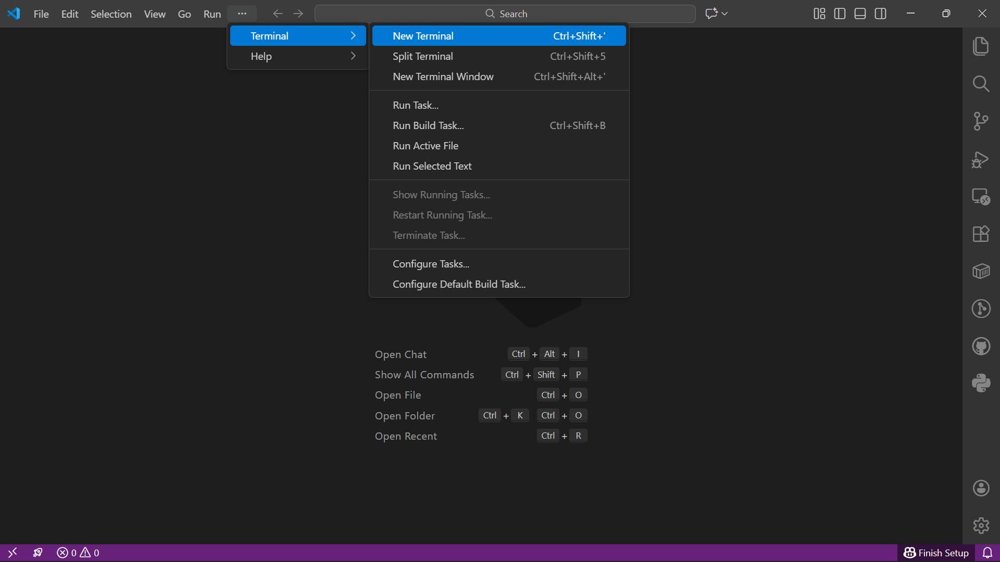 

You may notice we've opened a "PowerShell" terminal by default, this is the default Microsoft Windows scripting language, we want to change this to git Bash. Within the terminal you'll see the following symbols: `+ ⌄`. Click the down arrow and then click `Select Default Profile` (*see below*).

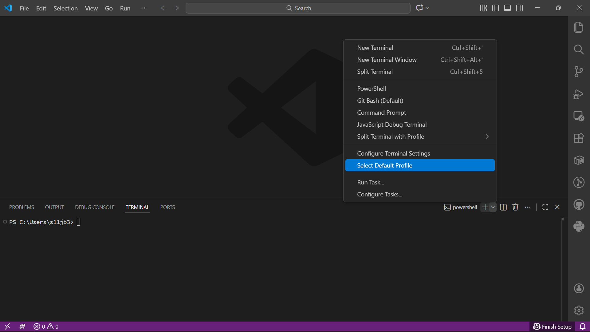 

A dropdown menu will appear prompting you to select your preferred default terminal, we want to select `Git Bash` (*see below*). 

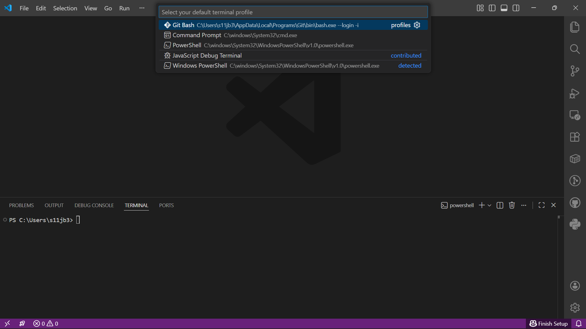 

VSCode will now open our git terminal by default. Remember, the terminal can be opened with `ctrl+shift+'` or from the top menu bar. To verify we installed git correctly, we can enter `git --version` into our terminal, if a version number appears (e.g. `git version 2.52.0.windows.1`) then we have correctly configured git.

### *4) Configuring GitHub credentials in VSCode*

Everything is now ready for us to connect our GitHub account to VScode. We need to set our username and email, we can do this in the git terminal by entering our GitHub credentials from earlier as follows: `git config --global user.name "abc123"` and `git config --global user.email "abc123@aberdeen.ac.uk"`. We can verify we entered the correct username and email by entering `git config user.name` and `git config user.email`.

(Optional) Setting up SSH

# **Practise Workflow**

We should now have configured our computer to use git, we'll practise on our shopping list. Firstly, lets create a folder for our git projects; You can place this anywhere you like, but for simplicity I prefer to create a "github-projects" folder in "Documents/". Next, open Explorer on the VSCode Explorer (looks like a stack of paper), click "Open Folder", then navigate to you "practise-shopping-list" folder (*see below, note your 'activity bar' may appear on the left rather than right side*).

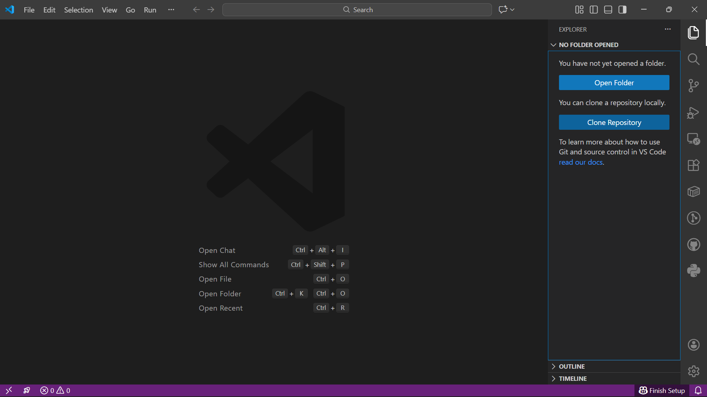 

> **🔔 IMPORTANT**: *It is important to maintain a consistent naming scheme when using GitHub. Generally it is recommended to name local repositories (project folders) all lowercase with words seperated by dashes, like so: "example-github-project". Additionally, we typically name files all lowercase with underscores, like so: "example_project_file.csv". It is important to strictly follow naming conventions once they've been agreed as this keeps our projects consistent, and this is especially important when we collaborate on projects with other people!*

### *1) Creating our shopping list*

We'll create a new plain text file called "shopping_list.txt" by right-clicking the explorer and selecting "New File..." (*see below*).

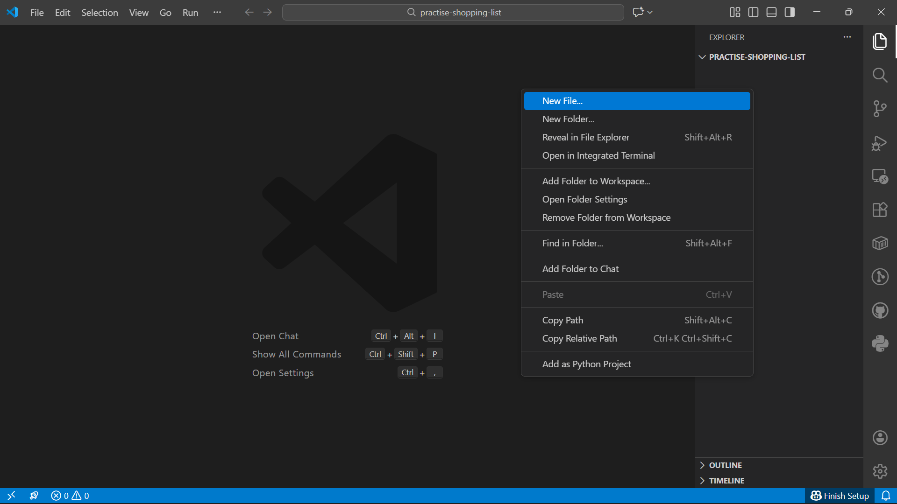 

Open your file and add some entries to your shopping list.

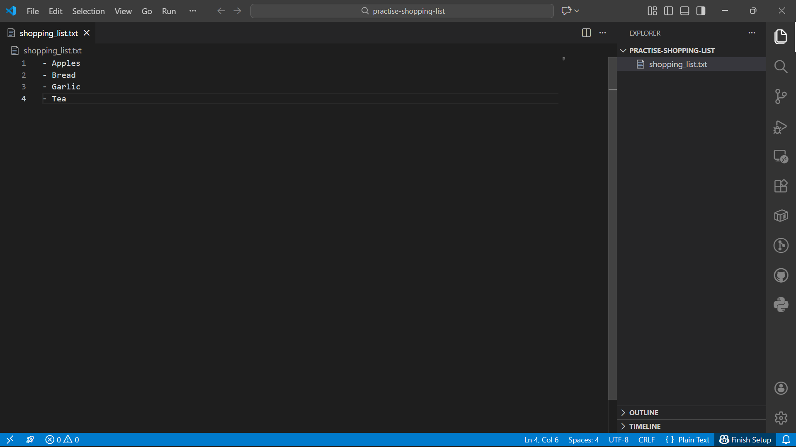 

### *2) Initialising git*
Now that we have our file and folder, lets introduce git. First, open the terminal with `ctrl+shift+'`, then enter `git init`. We'll recieve a message confirming we've initialised a git repository in our folder. The blue circle notification on the "Source Control" icon tells us we have one uncommitted change in our local repo (*see below*).

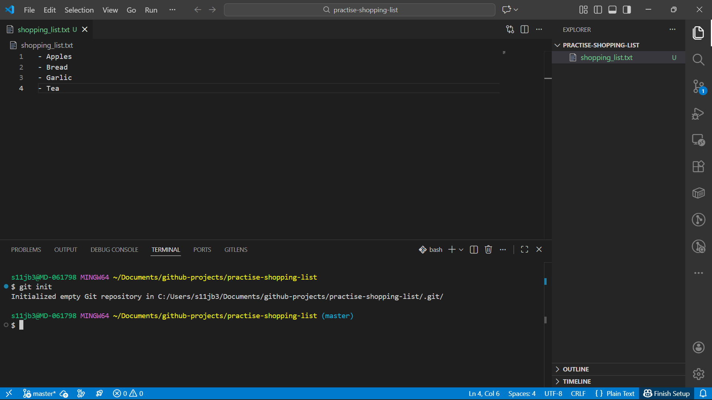 

### *3) Committing files to git*
We can now add our changes. Generally, when we first add our changes we enter the `git add .` command, where the dot (`.`) specifies "add everything". This adds everything in the folder to git's tracking. Next enter `git commit -m "Initialse repository."`, this will commit our changes and the message will signal that this is first commit.

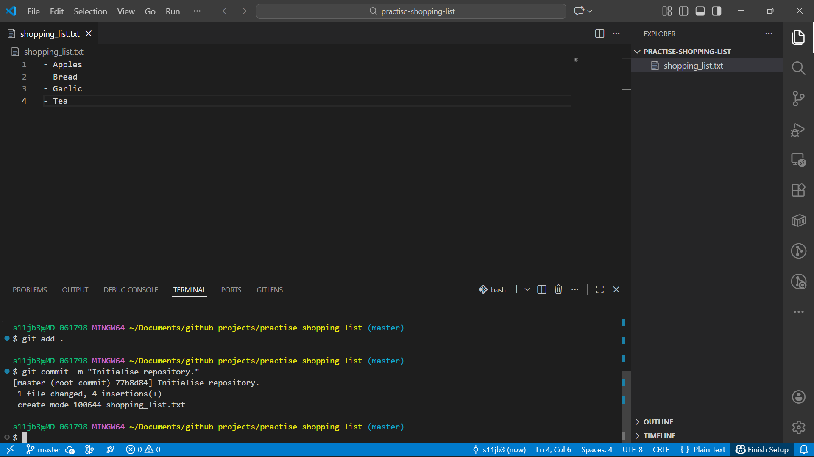 

### *4) Storing files on GitHub*
We've now tracked our changes locally and can continue to add and commit code, however to store our code on GitHub we'll need to make a "remote repository". Navigate [here](https://github.com/new) and enter the same folder name as your local repo, in our case we'll enter "practise-shopping-list", scroll down and click "Create repository", keeping all default settings (*see below*).

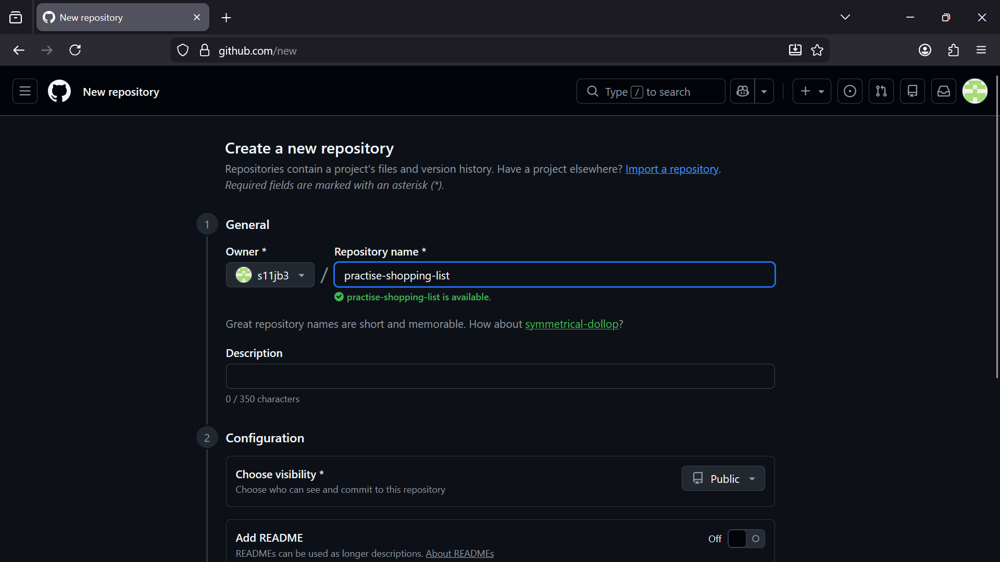 

> **🔔 IMPORTANT**: *While not strictly requied, it is strongly recommended to keep naming consistent between local and remote repositories, for example if you named your local folder "practise-shopping-list", name the new remote repo the same!*

You should be redirected to a GitHub setup screen which guides you through creating and pushing repositories. Scroll down to the bottom, we already have a local repository so we want to copy the code for the section titled "…or push an existing repository from the command line"; Press the copy button at right of code (two stacked squares) (*see below*).

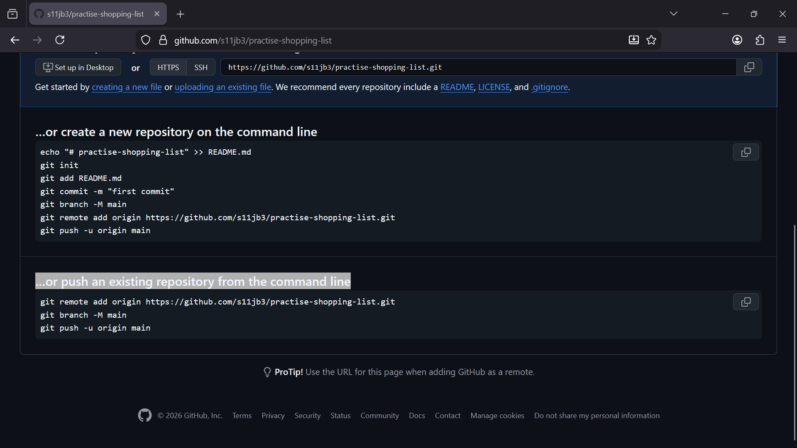 

Paste and enter this code into our terminal; This code adds our newly created remote repo to our local git folder, creates a new branch called "main" (we will discuss branching later), and then "pushes" our code to GitHub. You'll get an output showing that our changes were written to our remote repository (*see below*).

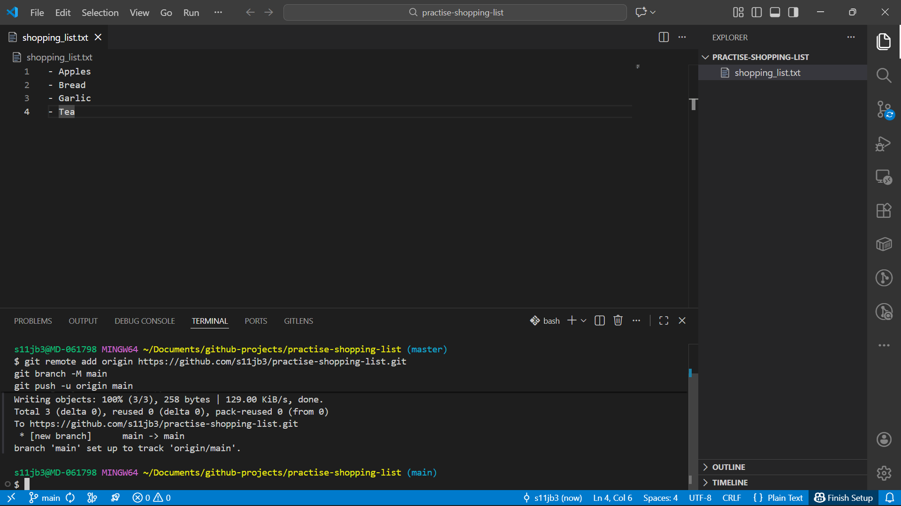 

Navigate to your new repository on GitHub "https://github.com/abc123/practise-shopping-list" (where "abc123" is your own username). We can now see our changes stored remotely in the GitHub cloud with our commit message "Initialise repository." (*see below*).

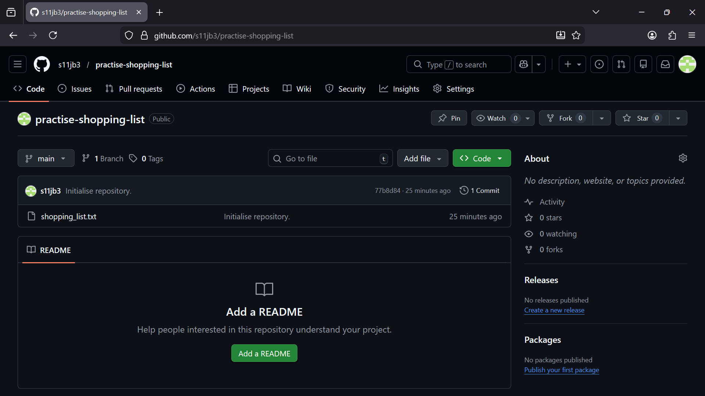 

Cick on our file to open it. You should see the same shopping list as on your local folder. Change the "Code" tab to "Blame" to show us who made the commit (in this case we know it was us). This section allows us to see who made which changes to files and when they were written (*see below*). 

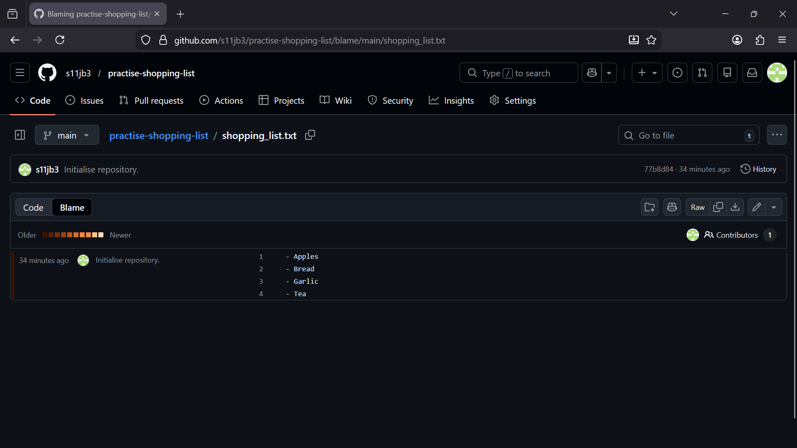 

> **🔔 IMPORTANT**: *git commit messages should *always* be written in 'imperative present tense'; For example, if we added carrots to our shopping list, our commit message would be something like "Add carrots to shopping list." rather than "Added". This is an established common convention, so it's best practise to get into this habit early!*

### *5) Tracking shopping list changes*
Let's update our shopping list with something new, maybe we want to get some pesto. Add pesto to your "shopping_list.txt" file and save. Again you'll note a new notification in the "Source Control" tab, indicating a new unstaged change. You'll also see an "M" tag beside your file, indicating a modification. 

When we make further changes, we won't use `git add .`, but rather we'll add files individually (here we'll use `git add shopping_list.txt`). This method allows us to commit with specific messages for each file so we can keep better track of what has changed in our project. Enter `git commit -m "Add pest to shopping list.` (*see below*).

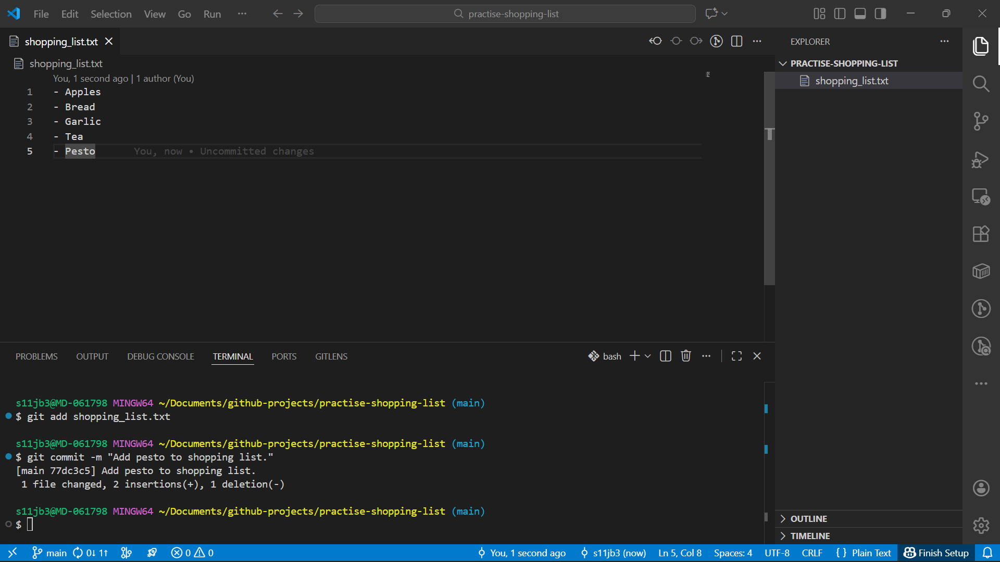 

Now we've committed our changes, we can write them to our remote repo by entering `git push`. Let's check our GitHub repo again to see if our new changes have appeared (*see below*).

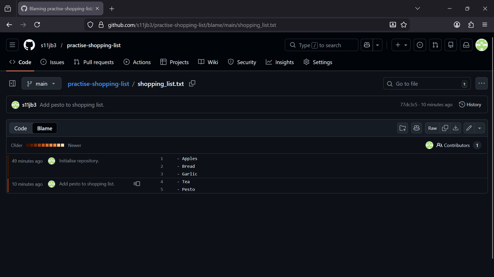 

Our changes have appeared with a new commit message, meaning our new changes have been successfully tracked, but why is "Tea" in our new commit? Adding a return after "Tea" is considered a modification by git, so it was included alongside "Pesto". Any changes made to a document will be added the next time you make a commit, so make sure you're committing your changes regularly with descriptive messages!

### *5) Pulling a remote repo*

So far, we've mostly been concerned about writing our updates from a repository we created. However, you may be added to an ongoing project where development has already occured and files already exist. As the name might suggest `git pull` it the opposite of `git push`. Wheras `push` moves local changes to remote repo, `pull` moves remote changes to local repo.

For example, say you share your shopping list with your friend Sally and you both plan on going shopping later in the week. Sally remembers she wants to get some mushrooms, so she adds that to her local list and stores it remotely. You realise you'd also like some bananas, so you add that to your local list and then try to store it remotely. A problem arises, your push is rejected because there are remote changes you haven't stored locally! (you're said to be 'behind' the remote). To solve this, you first `pull` the repo, make your changes, and *then* you can `push` the updated list (you may also imagine scenarios where changes are made by multiple users simultaneously, we'll cover `merge` later to address this). When Sally next opens the remote shopping list, she will see both mushrooms and bananas, as well as a "blame" for who entered what.